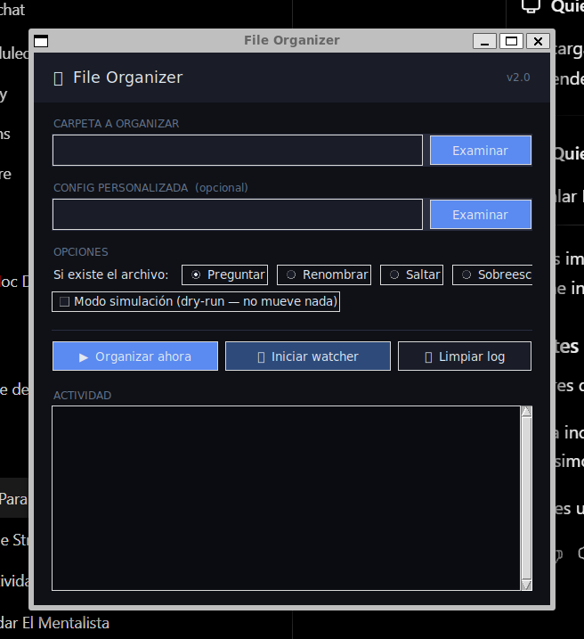

# 📁 FileOrganizer

**Organiza tus archivos automáticamente, sin complicaciones.**

FileOrganizer es una aplicación de escritorio que clasifica archivos en subcarpetas según su tipo. Utiliza detección por extensión y tipo MIME para identificar los archivos, e incluye un modo de vigilancia que organiza automáticamente los archivos nuevos.

Disponible para **Windows y Linux**.

---

## ✨ Características

- 📂 Organización automática por categorías.
- 🖥️ Interfaz gráfica sencilla e intuitiva.
- 👁️ Modo de vigilancia para organizar archivos nuevos en tiempo real.
- ⚙️ Configuración personalizada mediante archivos TOML o JSON.
- 🔄 Diferentes opciones para resolver conflictos entre archivos.
- 🧪 Modo de simulación para revisar los cambios antes de realizarlos.
- 📝 Registro de actividad para consultar las operaciones realizadas.
- 💻 Interfaz de línea de comandos (CLI) para usuarios avanzados.

---

## 📸 Interfaz gráfica



La interfaz permite seleccionar una carpeta, cargar una configuración personalizada, ajustar las opciones de organización y consultar las operaciones realizadas.

---

## 🚀 Instalación

Puedes descargar las versiones disponibles desde:

**[Descargar FileOrganizer — GitHub Releases](https://github.com/TonoConSal/TCS-FileOrganizer/releases)**

### 🪟 Windows

1. Accede a la sección de [Releases](https://github.com/TonoConSal/TCS-FileOrganizer/releases).
2. Descarga `FileOrganizer.exe`.
3. Ejecuta el archivo descargado.

No necesitas instalar Python ni dependencias adicionales.

### 🐧 Linux

Hay disponible un paquete `.deb` para distribuciones basadas en Debian, como Ubuntu y Linux Mint.

1. Accede a [Releases](https://github.com/TonoConSal/TCS-FileOrganizer/releases).
2. Descarga `FileOrganizer_2.5.0_amd64.deb`.
3. Abre el paquete con el instalador de software de tu distribución.
4. Haz clic en **Instalar**.
5. Busca FileOrganizer en el menú de aplicaciones.

También puedes instalarlo desde la terminal:

```bash
sudo apt install ./FileOrganizer_2.5.0_amd64.deb
```

El paquete está destinado a sistemas de arquitectura AMD64 (x86_64).

---

## 🖥️ Uso de la aplicación

1. Abre FileOrganizer.
2. Selecciona la carpeta que deseas organizar mediante **Examinar**.
3. Si lo deseas, carga un archivo de configuración personalizado.
4. Ajusta las opciones de organización.
5. Haz clic en **Organizar ahora**.
6. Consulta los resultados en la sección **Actividad**.

### Opciones disponibles

| Opción | Descripción |
|---|---|
| Preguntar | Solicita una decisión cuando encuentra un archivo con el mismo nombre. |
| Renombrar | Agrega un número al nombre del nuevo archivo. |
| Saltar | Omite el archivo si ya existe uno con el mismo nombre. |
| Sobrescribir | Reemplaza el archivo existente. |
| Modo simulación | Muestra qué archivos se organizarían sin moverlos. |
| Watcher | Supervisa la carpeta y organiza los archivos nuevos automáticamente. |

---

## 💻 Uso desde la terminal (CLI)

También puedes utilizar FileOrganizer directamente desde Python.

### Requisitos

- Python 3.11 o superior.
- `watchdog` para utilizar el modo de vigilancia.
- `tomli` si utilizas Python anterior a 3.11 y necesitas cargar archivos TOML.

Instala las dependencias opcionales:

```bash
pip install watchdog
```

Para Python anterior a 3.11:

```bash
pip install tomli
```

### Ejemplos

Organizar la carpeta Descargas:

```bash
python organizer.py
```

Especificar una carpeta:

```bash
python organizer.py ~/Descargas
```

Simular la organización sin mover archivos:

```bash
python organizer.py --dry-run
```

Activar el modo de vigilancia:

```bash
python organizer.py --watch
```

Utilizar una configuración personalizada:

```bash
python organizer.py --config organizer_config.toml
```

Combinar opciones:

```bash
python organizer.py ~/Descargas --watch --config mi_config.toml
```

---

## 📂 Categorías de archivos

FileOrganizer incluye las siguientes categorías predeterminadas:

| Categoría | Extensiones de ejemplo |
|---|---|
| Imágenes | `.jpg`, `.png`, `.gif`, `.webp`, `.svg` |
| Videos | `.mp4`, `.mkv`, `.avi`, `.mov`, `.webm` |
| Audio | `.mp3`, `.flac`, `.wav`, `.ogg`, `.m4a` |
| Documentos | `.pdf`, `.docx`, `.txt`, `.md`, `.odt` |
| Hojas de cálculo | `.xls`, `.xlsx`, `.csv`, `.ods` |
| Presentaciones | `.ppt`, `.pptx`, `.odp` |
| Código | `.py`, `.js`, `.cs`, `.html`, `.json`, `.yaml` |
| Ejecutables | `.exe`, `.msi`, `.apk`, `.deb`, `.rpm` |
| Comprimidos | `.zip`, `.rar`, `.7z`, `.tar.gz` |
| Fuentes | `.ttf`, `.otf`, `.woff`, `.woff2` |
| Torrents | `.torrent` |
| Diseño | `.psd`, `.ai`, `.xd`, `.fig`, `.sketch` |
| 3D | `.obj`, `.fbx`, `.stl`, `.blend` |
| Bases de datos | `.db`, `.sqlite`, `.sql`, `.mdb` |
| eBooks | `.epub`, `.mobi`, `.azw`, `.cbr` |
| ISO | `.iso`, `.img`, `.bin`, `.cue` |
| Otros | Archivos que no coincidan con ninguna categoría conocida. |

La detección también utiliza el tipo MIME como alternativa cuando una extensión no coincide con las categorías configuradas.

---

## ⚙️ Configuración personalizada

FileOrganizer permite modificar las categorías y agregar extensiones mediante archivos `.toml` o `.json`.

Ejemplo de configuración TOML:

```toml
[categories]
"Proyectos ROM" = [".gba", ".nds", ".ips", ".bps"]
"Godot" = [".tscn", ".gd", ".tres"]
```

Puedes encontrar archivos de configuración de ejemplo en el repositorio.

La configuración personalizada se carga desde la interfaz gráfica o mediante el argumento `--config` en la CLI.

---

## 🔍 ¿Cómo funciona la detección?

FileOrganizer utiliza el siguiente orden para identificar los archivos:

1. **Extensión compuesta:** comprueba extensiones como `.tar.gz`.
2. **Extensión simple:** comprueba extensiones como `.mp4`.
3. **Tipo MIME:** utiliza la biblioteca `mimetypes` como alternativa.
4. **Otros:** si no encuentra una categoría compatible, utiliza la carpeta `Otros`.

---

## 📝 Registro de actividad

La interfaz gráfica muestra las operaciones en tiempo real mediante diferentes niveles de registro:

- Información general.
- Advertencias.
- Errores.
- Información de depuración.

La versión CLI también genera un archivo `organizer.log` dentro de la carpeta organizada.

---

## 🛠️ Tecnologías utilizadas

- Python
- Tkinter
- Watchdog
- PyInstaller
- TOML / JSON
- Git y GitHub

---

## 🤝 Contribuciones

¿Tienes alguna idea para mejorar FileOrganizer?

Las sugerencias, reportes de errores y contribuciones son bienvenidos.

Puedes abrir un [Issue](https://github.com/TonoConSal/TCS-FileOrganizer/issues) o proponer cambios mediante un Pull Request.

## 🐛 Reportar problemas

Si encuentras algún error, abre un [Issue en GitHub](https://github.com/TonoConSal/TCS-FileOrganizer/issues) e incluye una descripción del problema, tu sistema operativo y los pasos necesarios para reproducirlo.

---

**Desarrollado por [TonoConSal](https://github.com/TonoConSal)**